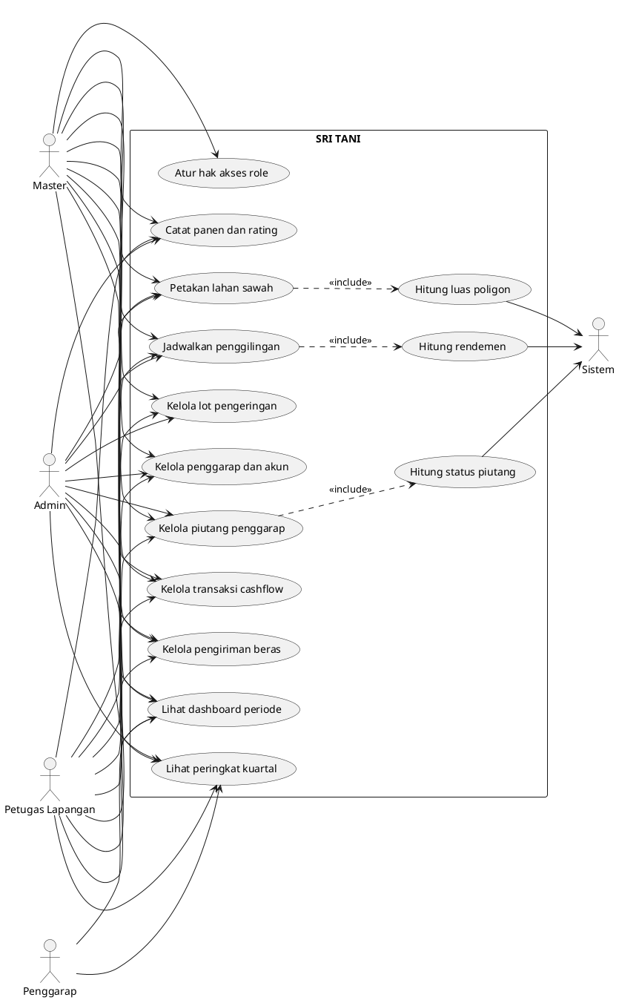
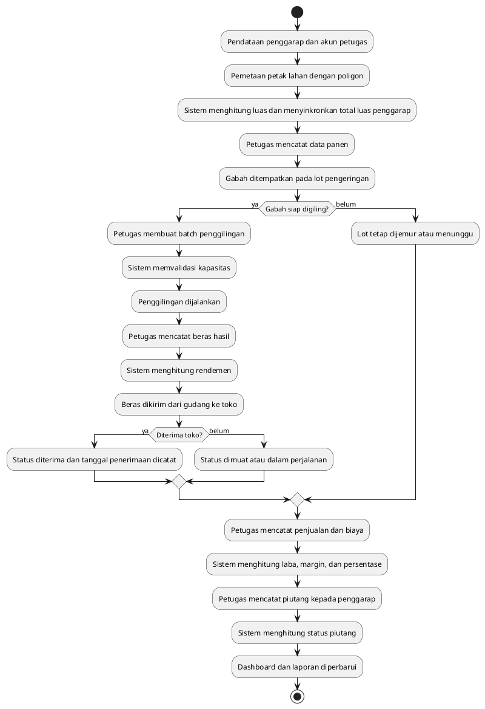
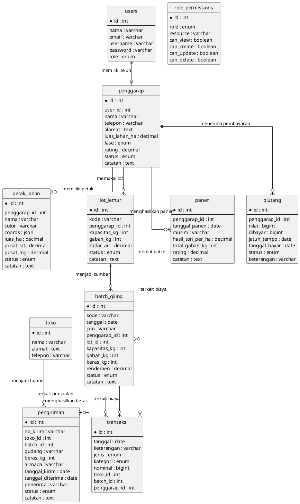
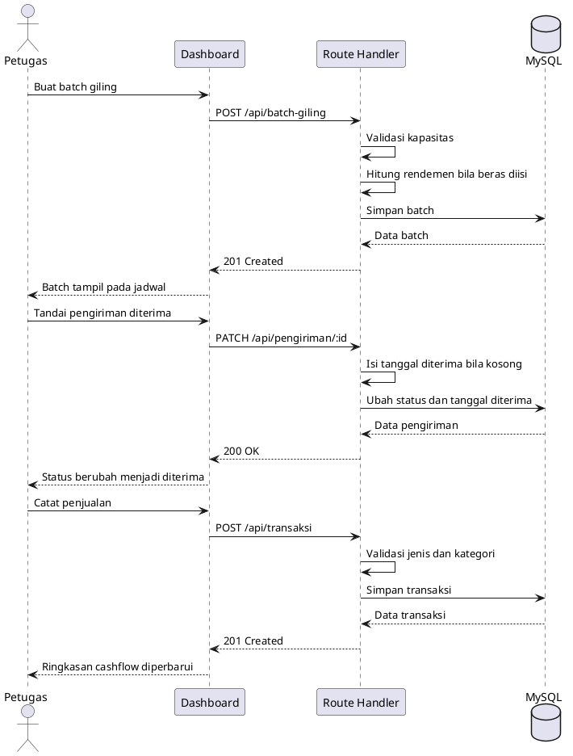
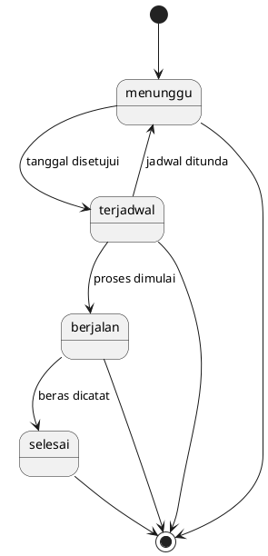
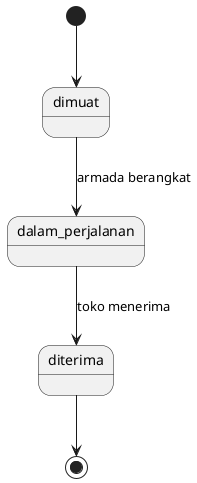
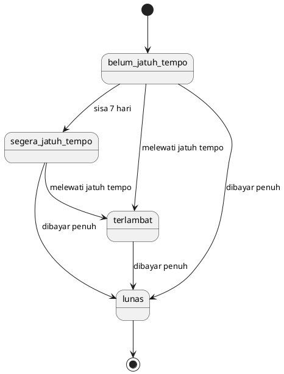
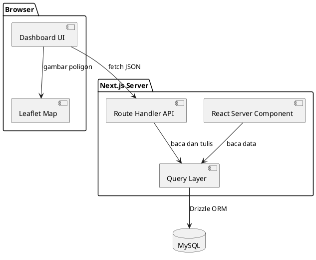

# SRI TANI

Sistem informasi manajemen agribisnis untuk pengelolaan lahan sawah, pengeringan gabah, penggilingan, distribusi beras, keuangan, dan piutang penggarap.

Aplikasi ini memakai Next.js 16, MySQL, Drizzle ORM, NextAuth, Chart.js, dan Leaflet. Dashboard menyajikan data per bulan dan tahun, sedangkan penilaian panen diagregasi per kuartal.

## 1. Aktor dan Hak Akses

| Aktor | Peran | Hak akses bawaan |
| --- | --- | --- |
| Master | Pemilik sistem | Akses penuh ke semua modul dan halaman Hak Akses untuk mengatur izin role lain |
| Admin | Administrator operasional | Melihat, menambah, mengubah, dan menghapus data operasional dan keuangan, tanpa halaman Hak Akses |
| Petugas Lapangan | Petugas operasional | Melihat semua modul, menambah dan mengubah data operasional dan keuangan, tanpa hapus |
| Penggarap | Akun mitra penggarap | Hanya melihat dashboard secara bawaan, modul lain dapat dibuka melalui izin Master |
| Sistem | Proses otomatis | Menghitung luas poligon, rendemen, status piutang, ringkasan cashflow, jadwal relatif, dan peringkat panen |

Hak akses disimpan per role dan per modul dalam tabel `role_permissions` dengan empat aksi: `view`, `create`, `update`, dan `delete`. Master dapat mengubah matriks ini melalui menu **Hak Akses**. Role Master selalu memiliki akses penuh dan tidak dapat dikurangi.

Registrasi mandiri selalu membuat akun dengan role `penggarap`. Akun `master`, `admin`, dan `petugas` dibuat oleh pengelola sistem atau melalui seeder.

## 2. Konsep Data Utama

| Entitas | Fungsi |
| --- | --- |
| `users` | Akun login, peran, dan identitas pengguna |
| `penggarap` | Data penggarap, luas lahan, fase tanam, status, dan akun petugas terkait |
| `petak_lahan` | Batas lahan berbentuk poligon, warna peta, luas otomatis, dan status petak |
| `lot_jemur` | Lot pengeringan gabah, kapasitas, isi, kadar air, dan status |
| `batch_giling` | Jadwal dan proses penggilingan gabah, gabah masuk, beras keluar, dan rendemen |
| `panen` | Catatan panen, hasil ton per hektar, total gabah, rating, dan musim |
| `toko` | Toko tujuan pengiriman beras |
| `pengiriman` | Pengiriman beras dari gudang ke toko, armada, penerima, dan status |
| `piutang` | Kewajiban usaha kepada penggarap, nilai dibayar, jatuh tempo, dan status |
| `transaksi` | Pemasukan dan pengeluaran untuk modal, operasional, penjualan, dan lainnya |
| `kandang`, `ternak` | Data pendukung peternakan yang tampil pada ringkasan publik |

## 3. Proses Bisnis End-to-End

1. Admin atau petugas mendaftarkan penggarap.
2. Sistem dapat membuatkan akun petugas untuk penggarap dengan username, email, dan kata sandi.
3. Petugas memetakan petak lahan pada peta dengan menggambar poligon minimal tiga titik.
4. Sistem menghitung luas petak dari koordinat, lalu menyinkronkan total luas ke data penggarap.
5. Petugas mencatat panen: tanggal, hasil ton per hektar, total gabah, dan rating.
6. Gabah ditempatkan pada lot pengeringan. Kapasitas dan isi lot dipantau.
7. Gabah yang siap digiling dijadwalkan sebagai batch penggilingan.
8. Jadwal penggilingan dikelompokkan menjadi hari ini, besok, minggu depan, dan jadwal lain.
9. Setelah penggilingan, petugas mencatat beras hasil dan sistem menghitung rendemen.
10. Beras dikirim dari gudang ke toko. Status pengiriman bergerak dari dimuat, dalam perjalanan, sampai diterima toko.
11. Penjualan, modal, dan biaya operasional dicatat sebagai transaksi.
12. Dashboard menghitung laba atau rugi, margin, persentase modal, dan persentase pengeluaran.
13. Kewajiban usaha kepada penggarap dicatat sebagai piutang penggarap.
14. Status piutang dihitung otomatis dari nilai dibayar dan tanggal jatuh tempo.
15. Peringkat panen dihitung per kuartal dari rata-rata hasil ton per hektar.

## 4. Aturan Bisnis

### 4.1 Periode

- Periode utama dashboard adalah bulan dan tahun.
- Filter periode memengaruhi transaksi, pengiriman, panen, dan piutang yang ditampilkan.
- Data lahan, lot, dan penggarap merupakan data induk yang tidak difilter per bulan.
- Peringkat panen memakai kuartal, bukan bulan.

### 4.2 Pemetaan Lahan

- Petak disimpan sebagai daftar koordinat `[lat, lng]`.
- Minimal tiga titik untuk membentuk poligon.
- Luas dihitung dengan proyeksi lokal dan rumus shoelace, lalu dikonversi ke hektar.
- Saat petak ditambah, diubah, atau dihapus, total luas penggarap dihitung ulang.

### 4.3 Lot Pengeringan

- Setiap lot memiliki kapasitas dalam kilogram.
- Isi lot tidak boleh melebihi kapasitas.
- Status lot: `kosong`, `dijemur`, `hampir_kering`, `siap_giling`.
- Utilisasi kapasitas ditampilkan pada halaman pengeringan.

### 4.4 Batch Penggilingan

- Setiap batch memiliki tanggal, jam, kapasitas, gabah masuk, dan status.
- Gabah masuk tidak boleh melebihi kapasitas giling.
- Rendemen dihitung otomatis: `beras_kg / gabah_kg * 100`.
- Status batch: `menunggu`, `terjadwal`, `berjalan`, `selesai`.
- Kelompok jadwal:
  - Hari ini: tanggal sama dengan tanggal server.
  - Besok: satu hari setelah tanggal server.
  - Minggu depan: Senin sampai Minggu pada minggu kalender berikutnya.
  - Jadwal lain: di luar tiga kelompok tersebut.

### 4.5 Pengiriman Beras

- Pengiriman mencatat gudang asal, toko tujuan, armada, beras yang dikirim, dan penerima.
- Alur status: `dimuat` -> `dalam_perjalanan` -> `diterima`.
- Saat status diubah menjadi `diterima`, sistem mengisi tanggal diterima bila belum ada.
- Tombol cepat Terima mencatat penerimaan pada tanggal hari ini.

### 4.6 Cashflow

- Transaksi memiliki jenis `pemasukan` atau `pengeluaran`.
- Kategori transaksi: `modal`, `operasional`, `penjualan`, `lain`.
- Pemasukan hanya boleh memakai kategori `penjualan` atau `lain`.
- Pengeluaran hanya boleh memakai kategori `modal`, `operasional`, atau `lain`.
- Rumus ringkasan:
  - Modal = total pengeluaran kategori `modal`.
  - Pengeluaran = total pengeluaran selain kategori `modal`.
  - Penjualan = total pemasukan.
  - Laba = penjualan - modal - pengeluaran.
  - Margin laba = laba / penjualan * 100.
  - Persentase modal = modal / penjualan * 100.
  - Persentase pengeluaran = pengeluaran / penjualan * 100.

### 4.7 Piutang Penggarap

- Piutang ini adalah kewajiban usaha kepada penggarap, misalnya bagi hasil panen yang belum dibayar.
- Status dihitung otomatis:
  - `lunas` jika nilai dibayar lebih besar atau sama dengan nilai piutang.
  - `terlambat` jika tanggal hari ini melewati jatuh tempo.
  - `segera_jatuh_tempo` jika jatuh tempo dalam tujuh hari ke depan.
  - `belum_jatuh_tempo` untuk kondisi lainnya.
- Jika status diubah menjadi `lunas`, sistem mengisi nilai dibayar sebesar nilai piutang dan tanggal bayar hari ini bila belum ada.

### 4.8 Rating Panen

- Rating dan hasil panen diagregasi per penggarap dalam satu kuartal.
- Rata-rata hasil dihitung dari seluruh catatan panen pada kuartal tersebut.
- Peringkat diurutkan dari rata-rata hasil ton per hektar tertinggi.
- Rating rata-rata hanya dihitung dari catatan yang memiliki nilai rating.

### 4.9 Role dan Izin Aksi

- Setiap request API diperiksa terhadap izin role dan resource.
- Halaman dashboard juga diperiksa pada server. Role tanpa izin `view` melihat halaman Akses dibatasi.
- Navigasi sidebar hanya menampilkan modul yang boleh dilihat role tersebut.
- Tombol tambah, ubah, dan hapus pada tabel mengikuti izin role.
- Master selalu memiliki akses penuh.
- Admin bawaan memiliki semua aksi pada semua modul operasional dan keuangan.
- Petugas bawaan memiliki aksi lihat, tambah, dan ubah, tanpa hapus.
- Penggarap bawaan hanya memiliki aksi lihat dashboard.
- Master dapat mengubah izin Admin, Petugas, dan Penggarap melalui `/dashboard/akses`.
- Perubahan izin berlaku pada request berikutnya. Pengguna cukup memuat ulang halaman.

## 5. Diagram UML

### 5.1 Use Case Diagram



### 5.2 Activity Diagram Proses Operasional



### 5.3 Entity Relationship Diagram



### 5.4 Sequence Diagram Penggilingan dan Pengiriman



### 5.5 State Diagram Batch Penggilingan



### 5.6 State Diagram Pengiriman



### 5.7 State Diagram Piutang Penggarap



### 5.8 Diagram Arsitektur Komponen



## 6. API CRUD

| Endpoint | Metode | Fungsi |
| --- | --- | --- |
| `/api/penggarap` | GET, POST | Daftar dan tambah penggarap, termasuk pembuatan akun petugas |
| `/api/penggarap/:id` | PATCH, DELETE | Ubah dan hapus penggarap |
| `/api/petak-lahan` | GET, POST | Daftar dan tambah petak lahan |
| `/api/petak-lahan/:id` | PATCH, DELETE | Ubah dan hapus petak lahan |
| `/api/lot-jemur` | GET, POST | Daftar dan tambah lot pengeringan |
| `/api/lot-jemur/:id` | PATCH, DELETE | Ubah dan hapus lot |
| `/api/batch-giling` | GET, POST | Daftar dan tambah batch penggilingan |
| `/api/batch-giling/:id` | PATCH, DELETE | Ubah dan hapus batch |
| `/api/panen` | GET, POST | Daftar dan tambah panen |
| `/api/panen/:id` | PATCH, DELETE | Ubah dan hapus panen |
| `/api/toko` | GET, POST | Daftar dan tambah toko |
| `/api/toko/:id` | PATCH, DELETE | Ubah dan hapus toko |
| `/api/pengiriman` | GET, POST | Daftar dan tambah pengiriman |
| `/api/pengiriman/:id` | PATCH, DELETE | Ubah dan hapus pengiriman |
| `/api/piutang` | GET, POST | Daftar dan tambah piutang penggarap |
| `/api/piutang/:id` | PATCH, DELETE | Ubah dan hapus piutang |
| `/api/transaksi` | GET, POST | Daftar dan tambah transaksi cashflow |
| `/api/transaksi/:id` | PATCH, DELETE | Ubah dan hapus transaksi |
| `/api/role-permissions` | GET, PUT | Baca dan ubah matriks izin role, khusus Master |
| `/api/akun` | GET, PATCH | Baca dan ubah pengaturan akun yang sedang masuk |
| `/api/public/summary` | GET | Ringkasan publik untuk halaman beranda |

Semua endpoint CRUD memerlukan sesi login. Setiap aksi diperiksa terhadap izin role dan resource. Role tanpa izin menerima respons 403.

## 7. Struktur Folder

```text
app/
  api/                  Route Handler REST API
  dashboard/            Halaman dashboard per modul
  (auth)/               Halaman login dan register
components/
  dashboard/            Komponen halaman dashboard
  ui/                   Modal, tabel CRUD, kartu statistik
db/
  schema.ts             Definisi tabel dan relasi Drizzle
lib/
  queries/              Query baca untuk server component
  api.ts                Helper autentikasi, guard izin, dan error API
  access.ts             Pemeriksaan akses halaman berbasis role
  permission-meta.ts    Resource, role, label, dan izin bawaan
  permissions.ts        Query izin role dari database
  payloads.ts           Validasi payload per entitas
  period.ts             Periode, kuartal, dan jadwal relatif
  geo.ts                Perhitungan luas poligon
scripts/
  seed.mjs              Seeder data awal
drizzle/
  0000_talented_glorian.sql  Migrasi skema awal
  0001_jazzy_iron_patriot.sql  Migrasi role dan role_permissions
```

## 8. Menjalankan Aplikasi

Prasyarat:

- Node.js 20 atau lebih baru.
- MySQL 8 atau MariaDB yang kompatibel.
- Database `db_sri_tani`.

Konfigurasi `.env.local`:

```env
DATABASE_URL_UTAMA="mysql://root@127.0.0.1:3306/db_sri_tani"
DATABASE_URL="mysql://root@127.0.0.1:3306/db_sri_tani"
AUTH_SECRET="ganti-dengan-secret-yang-aman"
AUTH_TRUST_HOST="true"
```

Langkah menjalankan:

```bash
npm install
npm run db:push
npm run db:seed
npm run dev
```

Jika database masih memakai tabel dari versi lama, kosongkan database terlebih dahulu atau terapkan migrasi `drizzle/0000_talented_glorian.sql` dan `drizzle/0001_jazzy_iron_patriot.sql` pada database kosong.

Akun hasil seeder:

| Peran | Username | Kata sandi |
| --- | --- | --- |
| Master | `master` | `password123` |
| Admin | `admin` | `password123` |
| Petugas Lapangan | `petugas` | `password123` |
| Penggarap | `slamet` | `password123` |
| Penggarap | `rudi` | `password123` |
| Penggarap | `sutrisno` | `password123` |
| Penggarap | `wahyu` | `password123` |
| Penggarap | `agus` | `password123` |
| Penggarap | `siti` | `password123` |

## 9. Batasan Implementasi

- Izin role saat ini berlaku pada level aksi dan modul. Pembatasan baris data, misalnya penggarap hanya melihat datanya sendiri, belum diterapkan.
- Pengaturan yang tersedia baru pengaturan akun, belum pengaturan organisasi yang dapat diedit.
- Piutang baru mendukung satu arah, yaitu kewajiban usaha kepada penggarap.
- Cashflow memakai kategori transaksi, belum memisahkan tabel modal awal.
- Peringkat panen memakai rata-rata sederhana per penggarap, belum mempertimbangkan bobot luas lahan.
- Peta memakai tile satelit Esri sehingga membutuhkan koneksi internet.
- Registrasi mandiri selalu membuat role `penggarap`. Role lain dibuat melalui seeder atau pengelolaan langsung oleh Master.
